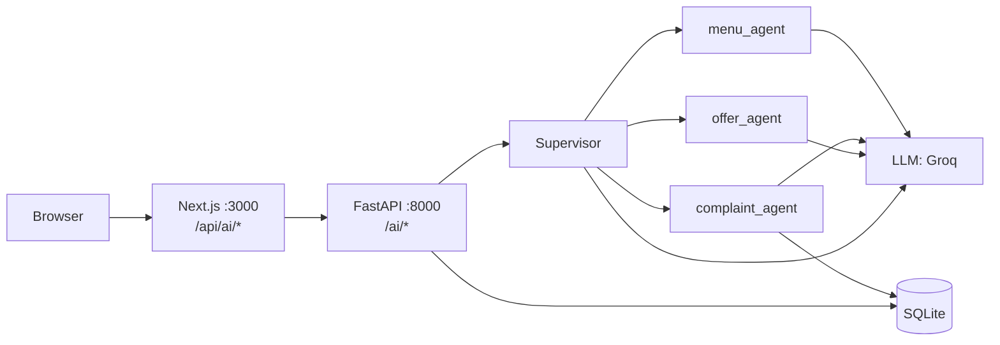

# Xander Bot

A customer support chatbot for Xander Restaurant (a demo restaurant). A FastAPI + LangGraph backend runs the agents, and a Next.js app provides the chat UI.

## What it is for

| A customer asks about | What happens |
|---|---|
| Menu and prices (PKR) | `menu_agent` reads the menu with `fetch_menu` |
| A problem with an order | `complaint_agent` collects name, phone, order ID and complaint, checks the order ID and saves it |
| Discounts | `offer_agent` returns today's offer |
| A greeting | The supervisor answers directly |

## Why it is built this way

| Choice | Reason |
|---|---|
| Supervisor with worker agents | Each worker has a short prompt and only its own tools, so a new topic means a new worker |
| Tools for menu, orders and complaints | Facts and writes go through Python, not the model's memory |
| SQLite | Chat history and complaints persist without a database server |
| Next.js proxy | The browser calls its own origin, so the backend URL stays server-side |
| Groq or Ollama | Both use the OpenAI API format, so one client class covers hosted and local models |

## High-level design (HLD)



One chat turn:

1. The UI sends `{query, session_id}` to the Next.js proxy, which forwards it to FastAPI.
2. The backend loads that session's history from SQLite.
3. The supervisor routes the question to a worker. The worker calls its tools and answers.
4. All new messages are saved in one transaction, and the answer is returned.

## Low-level design (LLD)

### Backend (`backend/`)

| File | Responsibility |
|---|---|
| `main.py` | App setup, CORS, API key middleware, table creation at startup |
| `middlewares/authenticate.py` | Compares the `X-API-KEY` header with `AUTHENTICATED_KEY`. `/`, `/docs` and `/openapi.json` are public |
| `modules/ai_agent/router.py` | `POST /ai/chat`, `GET /ai/history` |
| `modules/ai_agent/schema.py` | Request model |
| `modules/ai_agent/service.py` | Load history, run the graph, save messages, pick the answer to return |
| `modules/ai_agent/supervisor.py` | Builds the supervisor and its three workers |
| `modules/ai_agent/graph.py` | Model settings, plus a single-agent graph (`assistant` ⇄ `tools`) as an alternative |
| `modules/ai_agent/tools.py` | `fetch_menu`, `validate_order_id`, `log_complaint`, `get_discounts` |
| `modules/knowledge/service.py` | RAG indexing and search with Chroma (not connected to the agents) |
| `core/settings.py` | Paths and `.env` loading |
| `core/database/sqlite.py` | Message and complaint storage |

### Frontend (`frontend/src/`)

| Path | Responsibility |
|---|---|
| `app/api/ai/` | Proxy routes with input validation |
| `lib/backend.ts` | Forwards to FastAPI (3 minute timeout), hides backend error details |
| `lib/api.ts`, `lib/contracts.ts` | Browser calls and response validation |
| `lib/storage.ts` | Conversation list in `localStorage` |
| `hooks/use-chat.ts` | Conversation state |
| `components/` | Chat UI |

### API

```text
POST /ai/chat
  body:     { "query": "...", "session_id": "..." }
  response: { "session_id": "...", "answer": "..." }

GET /ai/history?session_id=...
  response: { "session_id": "...", "messages": [ { "role": "user" | "ai", "content": "..." } ] }
```

### Data model (`backend/data/history.sqlite3`)

| Table | Columns |
|---|---|
| `messages` | `id`, `session_id`, `message_json` (LangChain message) |
| `complaints` | `id`, `customer_name`, `order_id`, `phone`, `complaint`, `status` (default `Pending`) |

The menu, the offer and the valid order IDs (`OR-1045` to `OR-1047`) are hardcoded in `tools.py`.

## Setup

### Requirements

- Python 3.11+ and [uv](https://docs.astral.sh/uv/)
- Node.js 22.17+
- A [Groq](https://console.groq.com) API key

### 1. Backend

```bash
cd xander-bot/backend
uv sync
cp .env.example .env
```

In `.env`:

| Variable | Value |
|---|---|
| `GROQ_API_KEY` | Required |
| `GROQ_MODEL` | Optional, default `openai/gpt-oss-120b` |
| `AUTHENTICATED_KEY` | Required: any long random string (`openssl rand -hex 32`). If unset, every API call is rejected |
| `OPENROUTER_API_KEY` | Only for knowledge indexing |
| `DATA_DIR` | Optional, default `backend/data` |

```bash
uv run fastapi dev main.py      # http://localhost:8000, API docs at /docs
```

To use a local model, change `build_supervisor("groq")` to `build_supervisor("ollama")` in `modules/ai_agent/service.py`, run Ollama, and set `OLLAMA_MODEL` (default `qwen3:4b`).

### 2. Frontend

In a second terminal:

```bash
cd xander-bot/frontend
npm install
cp .env.example .env.local      # set BACKEND_API_KEY to the AUTHENTICATED_KEY value
npm run dev                     # http://localhost:3000
```

### Checks

```bash
# backend/
uv run python -m unittest tests.test_agent

# frontend/
npm run lint && npm run typecheck && npm run build && npm test
```

## Known issues

- **One shared API key, no user accounts.** The frontend adds the key on the server, so anyone who can reach the frontend can use the API.
- **No session ownership.** Anyone who knows a session ID can read its history.
- **RAG is not connected.** You can index the knowledge base with `uv run python -m scripts.ingest`, but no agent tool searches it yet.
